# Staff aur Academic Setup — Hinglish Walkthrough

## Is guide ka maqsad

Yeh guide batati hai ki Host ke Staff Category catalogue se shuru karke ek institution apni staff hierarchy, academic classes/courses aur curriculum kaise configure karta hai, aur banaye gaye records aage kahan use hote hain. Example institution **Red Rose St Marry School** hai; professional-structure example **Student Services → Student Wellbeing → Student Counsellor** hai.

**Evidence ki had:** Host aur Red Rose Institution Staff accounts se local API login aur read-backs 14 October 2026 ko verify hue. `Student Services` pehle se active tha, isliye duplicate nahi banaya. Neeche ke screenshots aapke diye hue UI screenshots hain, nayi browser capture nahi.

## Pehle dependencies samjhein

```text
Host Staff Category (platform meaning)
  └─ Institution category mapping (institution ka use/allowed families)
       └─ Job Family
            └─ Position
                 ├─ Required/optional Capabilities
                 ├─ Default Duties
                 └─ Staff Member ki effective position assignment

Academic Session
  └─ Programme
       └─ Academic Group (Grade / Year / Batch)
            └─ Section (5-A, 5-C, ya sirf 5-A)

Session + Group + Subject
  └─ Course Offering
       └─ Curriculum Framework → Unit → Topic
            └─ Teaching Assignment → Lesson Plan → Review → Delivery Log
                 └─ Derived Syllabus Progress
```

Professional hierarchy aur academic hierarchy alag cheezein hain. `Teacher` ya `Student Counsellor` ek job position hai; `Grade 5-C Mathematics` ek academic teaching assignment/course context hai. Non-teaching staff ko academic group, subject ya lesson plan dena zaroori nahi.

## Step 1 — Host category catalogue

Host Admin **Staff Category Catalogue** mein platform ke shared category types maintain karta hai. Screenshot mein `Student Services` active category hai. Iska code `STUDENT_SERVICES` hai; iska arth counselling, wellbeing aur learner-support staff hai. Local authenticated Host API read-back mein yeh category phir mili. Dobara `Add` karne se duplicate-code conflict aayega, isliye institution setup mein isi active row ko select karna hai. Is run mein naya category insert zaroori nahi tha—existing record ko use kiya.

`StaffCategory` global semantic catalogue hai. Host ka deactivate action category ko naye institution mappings ke liye rokta hai; pehle se bane institution records ko delete nahi karta. Institution category mapping institution ki apni working configuration hai.

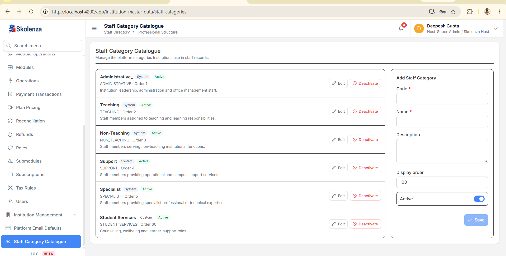

Host module permission bhi existing Host menu se runtime par resolve hoti hai. Is local login mein category module ke liye `Add`, `Update` aur `View` operations menu se aaye; client ko in numeric IDs ko code ya database mein fix nahi karna chahiye.

## Step 2 — Institution category ko map karein

Institution Admin **Staff Directory → Professional Structure → Staff Categories** kholta hai. Host catalogue se `Student Services` choose karke institution category entry banata/maintain karta hai aur uske neeche allowed Job Families map karta hai. Is example mein local working category ka display name `Student Services` hi rakha gaya hai aur family `Student Wellbeing` hai.

Is mapping ka matlab: is institution mein `Student Wellbeing` family ko `Student Services` ke andar rakhna valid hai. Doosre institution ki mapping ya family isse share nahi hoti.

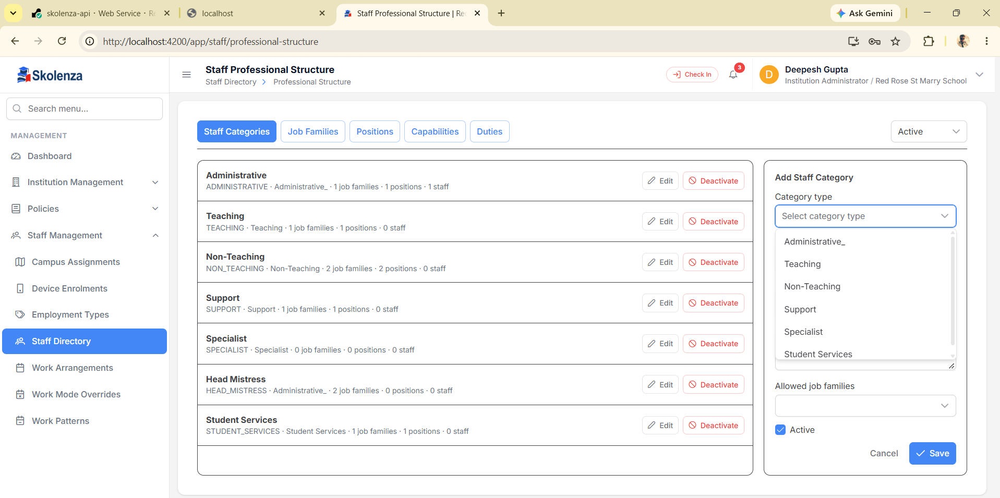

## Step 3 — Job Family banayein

Job Family broad functional team hoti hai, position nahi. Example: category `Student Services` ke andar family `Student Wellbeing` hai. Yeh family counsellor, safeguarding coordinator ya wellbeing officer jaise related roles ko ek jagah group kar sakti hai.

School ke alag examples: `Academics`, `Finance & Accounts`, `Facilities & Maintenance`. College mein `Faculty – Computer Science`; coaching centre mein `Entrance Preparation` use ho sakta hai. In names ko har institution apni zaroorat se configure karega.

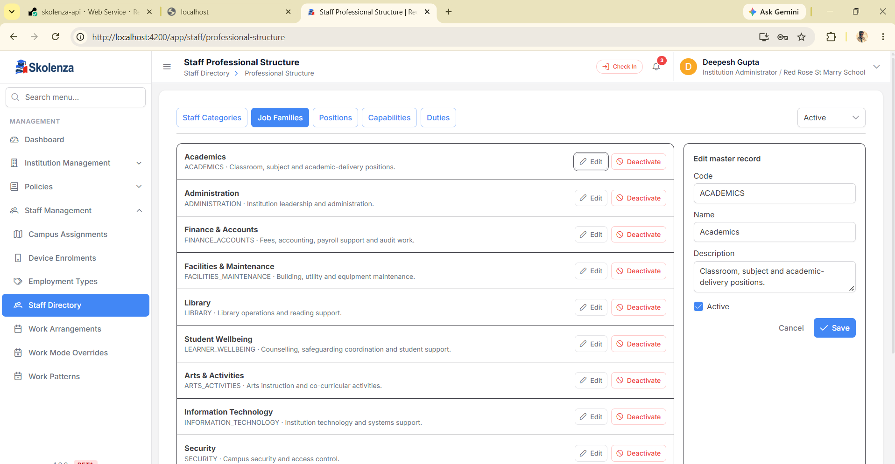

## Step 4 — Capabilities aur Duties define karein

**Capability** batati hai ki vyakti ko kaunsa kaam karne ki skill/qualification honi chahiye. Example `Student Counselling` capability hai. **Duty** batati hai ki position mein rozmarra kaun sa kaam expected hai. Example `Deliver student wellbeing support` duty hai. Capability aur Duty khud job title nahi hain.

Position mein capability mandatory ya optional ho sakti hai. Jaise `Student Counsellor` ke liye counselling capability required rakhein; first-aid capability sirf tab add karein jab institution ki policy mein relevant ho. Default duty position se naye Staff Member ke duty assignments tak copy hoti hai, jahan woh apne effective assignment ke saath dikhai jaati hai.

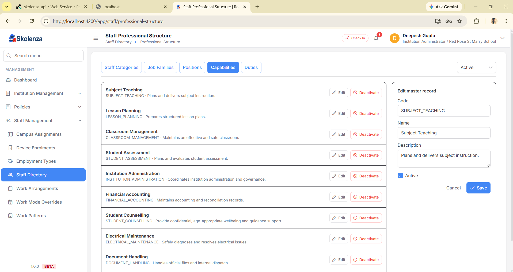

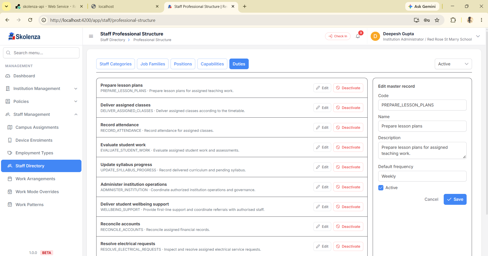

## Step 5 — Position banayein aur staff ko assign karein

**Position** family ke andar concrete post hai. Is example mein:

```text
Category: Student Services
Job Family: Student Wellbeing
Position: Student Counsellor
Required capability: Student Counselling
Default duty: Deliver student wellbeing support
```

Position banate waqt active institution category/family aur required capabilities/duties select honi chahiye. Staff Directory mein naya staff member banate/edit karte waqt wahi category aur position select hoti hai. API check karti hai ki position active hai, isi institution ki hai aur selected category/family mapping ke andar valid hai. Position save karne se staff profile apne aap nahi banti; staff member ko alag create/edit flow mein onboard karna hota hai. Current local API read-back mein category ke liye 1 active family aur 1 active position mila, lekin `activeStaffCount` 0 hai—Student Counsellor position abhi kisi staff profile ko assign nahi hui.

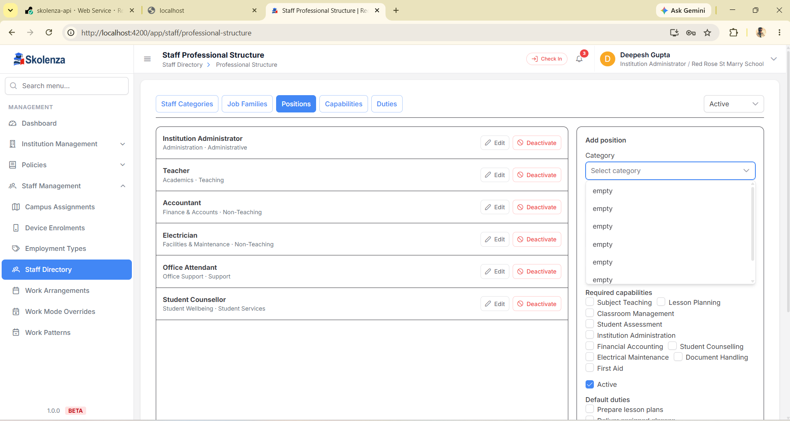

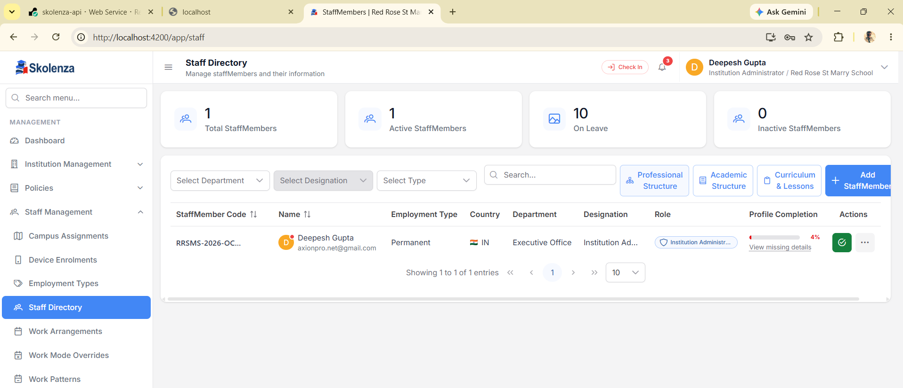

**Screenshot mein dikhne wali UI dikkat:** Position form ka category dropdown screenshot mein `empty` labels dikhata hai, jabki list mein position aur family ke naam nazar aate hain. Host category screenshot mein `Administrative_` naam bhi extra underscore ke saath hai. Yeh screenshot se observed presentation/data-quality issues hain; is guide mein inka cause assume ya unka code fix nahi kiya gaya. Agar aapko form mein bhi yahi dikhe, to ise successful UI acceptance na samjhein. Existing local API setup/read-back aur current browser label rendering alag verifications hain.

## Step 6 — Academic Session aur Programme

Yeh setup teaching/learning ke liye hai. Har institution apna **Session** aur **Programme** banata hai:

| Institution | Session example | Programme example |
| --- | --- | --- |
| School | Academic Year 2026–27 | Primary / Middle / Secondary School |
| College | Semester Cycle 2026–27 | B.Sc. Computer Science / B.Com. |
| Coaching centre | JEE 2027 Batch Cycle | JEE Foundation / NEET Target |

Session dates us avadhi ko define karti hain. Programme batata hai learner kis course/stage mein hai. `Grade` ko code mein fix karne ki zaroorat nahi. Current authenticated local read-back mein 1 active session (`Academic Year 2026–27`), 3 programmes aur 10 academic groups mile.

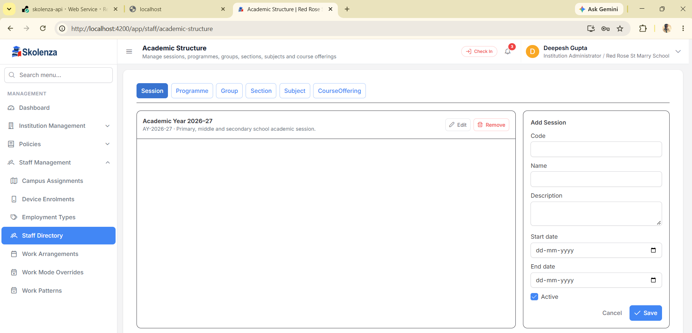

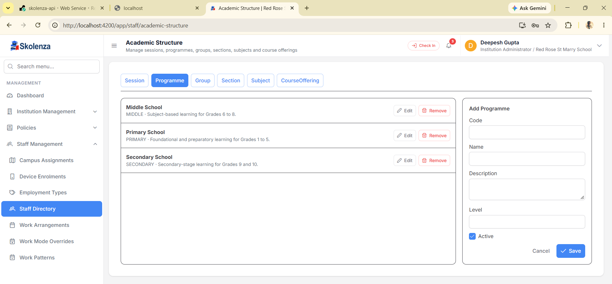

## Step 7 — Academic Group aur Sections

**Academic Group** class/year/batch ka main container hai. School mein `Grade 5`; college mein `B.Sc. First Year` ya `B.Tech. Semester 3`; coaching mein `JEE Morning Batch` ho sakta hai.

**Section** us group ke andar institution ke zaroorat ke mutabiq banta hai. Grade 5 mein sirf `5-A` ho sakta hai; ya `5-A`, `5-B`, `5-C` ho sakte hain. College mein `CSE Semester 3 – Batch B`, coaching mein `JEE Morning – Batch A` ho sakta hai. Admin ko jitne sections chahiye utne banane hain; system ko har grade ke liye A aur B assume nahi karna chahiye. Capacity optional institution planning value hai. Current Red Rose read-back mein Grade 5 ke do active sections—A aur B—mile; 5-C abhi configured nahi hai.

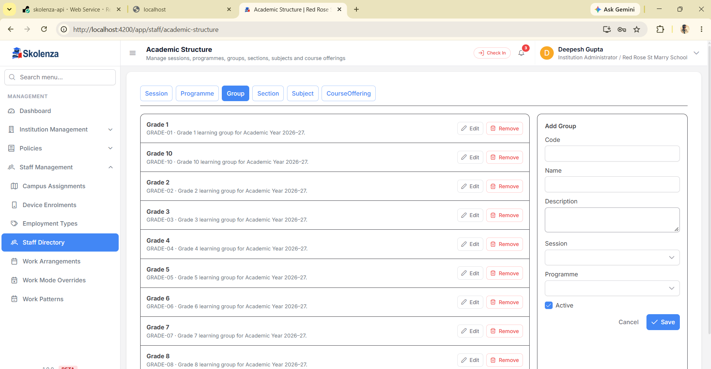

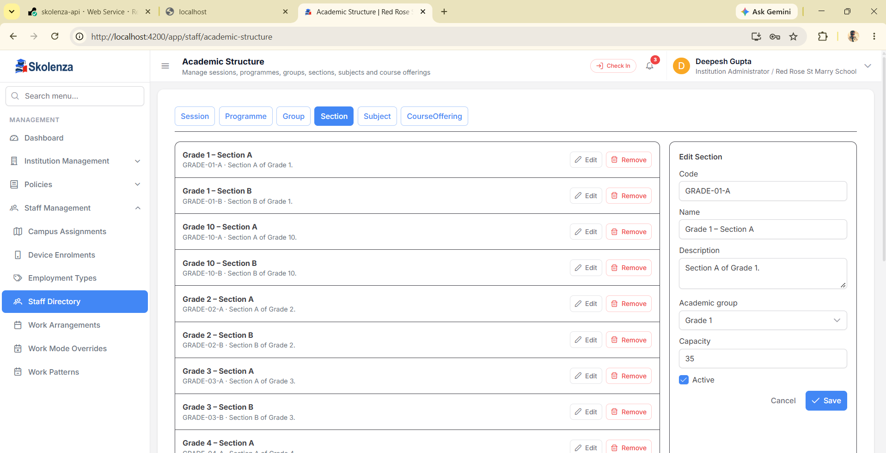

## Step 8 — Subject aur Course Offering

Subject catalogue mein `Mathematics`, `English`, `Data Structures` ya `JEE Advanced Mathematics` jaisa subject define hota hai. **Course Offering** us subject ko ek session aur group ke saath jodta hai:

```text
Session: Academic Year 2026–27
Group: Grade 5
Subject: Mathematics
Course Offering: Grade 5 – Mathematics
```

Grade 5 ke ek ya teen sections hon, course offering phir bhi Grade 5 Mathematics ko represent kar sakti hai; actual staff delivery section-specific teaching assignment mein hoti hai. College example `Semester 3 + Data Structures`; coaching example `JEE 2027 Morning Batch + Advanced Mathematics` hai.

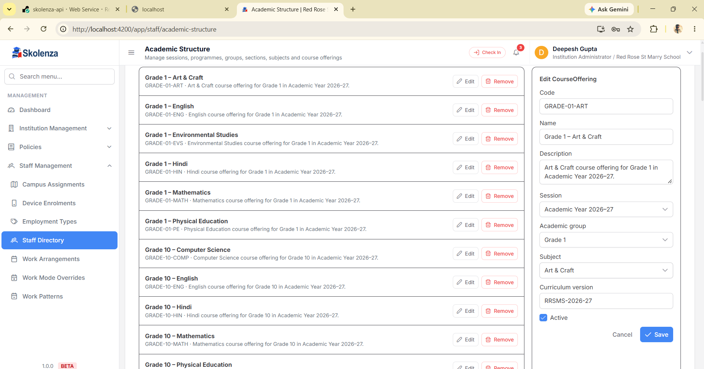

## Step 9 — Framework, Units aur Topics

Curriculum Framework ek approved syllabus version ko session, board/university aur effective dates se jodta hai. Framework ke andar course offering select karke **Units** aur phir har Unit ke **Topics** add karein. Planned periods batate hain kitna class time diya gaya; learning outcome topic/unit ka expected result hai.

Example:

```text
Framework: School Curriculum Framework 2026–27
Course: Grade 5 – Mathematics
Unit: Fractions
Topics: Equivalent Fractions, Addition, Word Problems
Planned time: institution ke timetable ke mutabiq
```

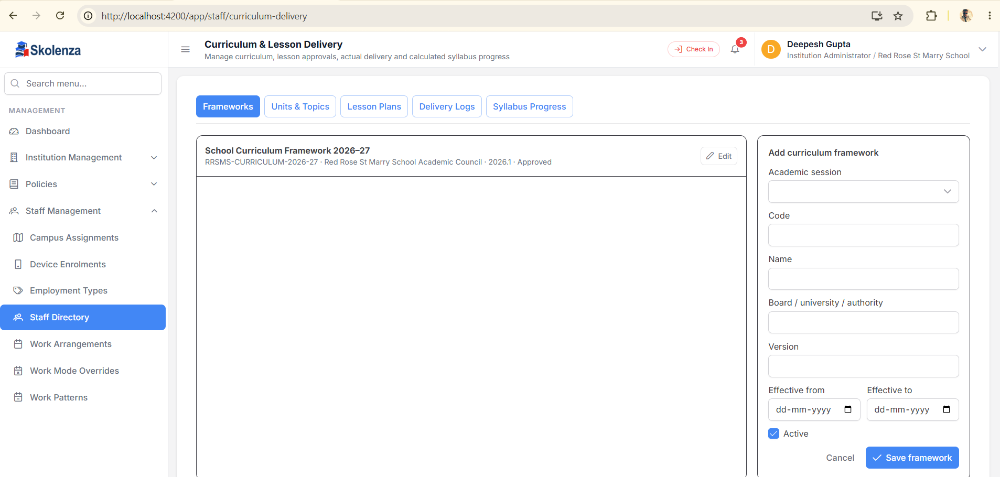

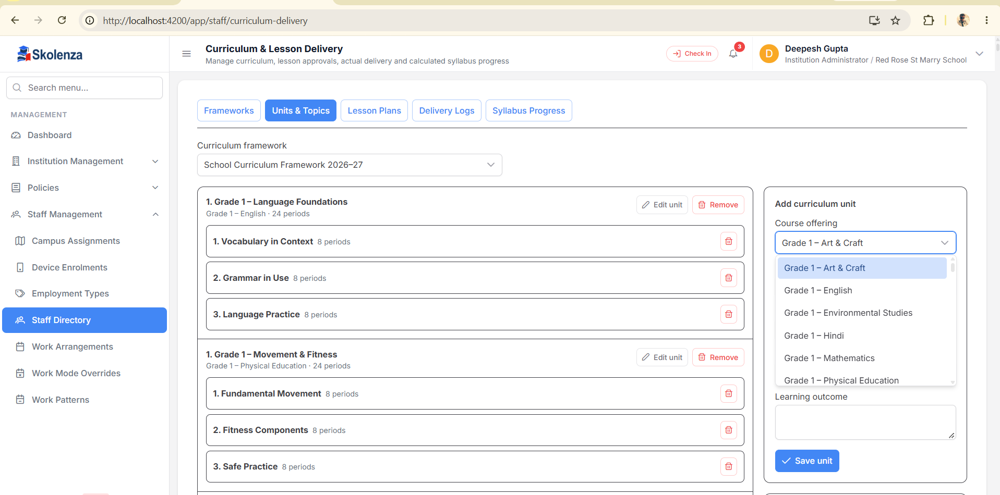

## Step 10 — Teaching Assignment, Lesson Plan, Delivery aur Progress

Lesson Plan ek **effective teaching assignment** aur us course offering ke ek ya adhik topics ko select karta hai. Plan mein date, period reference, objectives, method, resources, activity, assessment aur homework likhe ja sakte hain. `Save draft` sirf Draft save karta hai. Uske baad authorized institution user existing permission pipeline ke through status review karta hai; valid transitions `Draft/Rejected → Submitted → Approved/Rejected` hain. Current curriculum contract mein dynamic named approver chain/step configuration ka evidence nahi mila. Timetable ka Phase 4 workflow alag hai: wahan institution manager/role/position/staff approvers aur publish rule configure karta hai. Dono approval flows ko ek na samjhein. Approved plan ke baad hi uska actual Lesson Delivery Log record kiya ja sakta hai.

```text
Teacher assignment: Grade 5-A Mathematics (current configured example)
Lesson draft: Equivalent Fractions
Reviewer: institution ke curriculum approval setup mein assigned approver
Approved plan → delivered date/coverage/notes → approved delivery
Syllabus progress: approved topic coverage se calculate hoti hai
```

**Current local state:** ek active teaching-assignment row `Grade 5 – Mathematics` aur `Grade 5 – Section A` se linked hai, lekin API read-back mein named staff member/Staff Member ID blank hai. Lesson Plan list 0, Delivery Log list 0 aur syllabus-progress projection 222 rows, sab 0% hai. Iska matlab curriculum catalogue bana hua hai, magar saved lesson, approved delivery ya progress abhi nahi. Isko end-to-end chalane ke liye pehle real teacher ko Staff Directory mein onboard karke teaching assignment se link karna hoga; teacher details ke bina kisi vyakti ko assign nahi kiya.

Lesson plan approval aur Phase 4 timetable approval alag workflows hain. Timetable ke liye institution decide kar sakta hai teacher Draft propose kare ya manager banaye, kaun se role/position/manager review kare, aur final approval ke baad auto-publish ho ya authorized user manually publish kare. API current workflow step aur actor permission validate karti hai; status dekhkar hi approve/publish permission nahi milti.

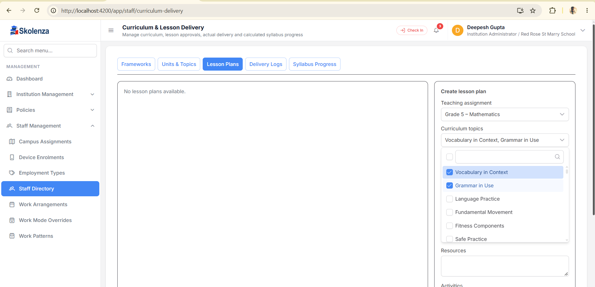

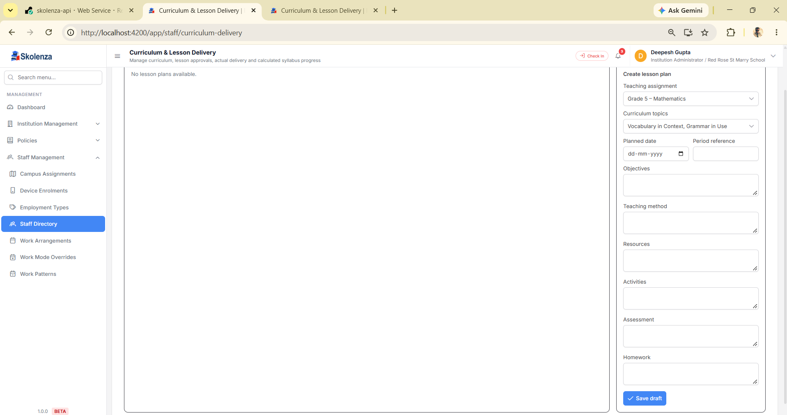

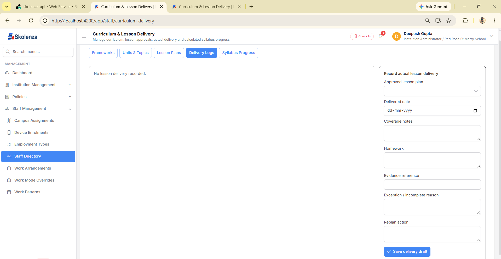

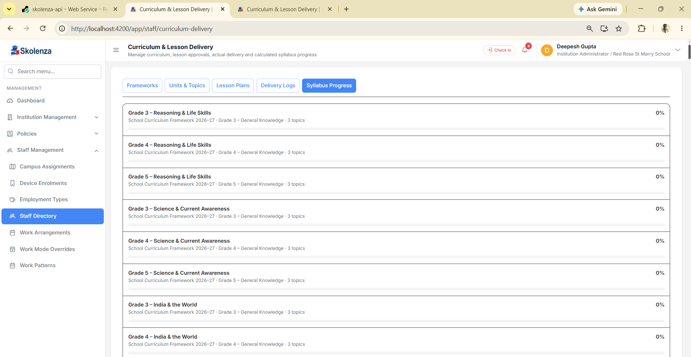

## “Yeh record aage kahan use hota hai?”

| Record | Baad mein use |
| --- | --- |
| Host Staff Category | Institution professional category ke canonical type/meaning ke liye; active options ko seed karta hai |
| Institution category + allowed Job Family mapping | Professional Structure aur Staff create/edit dropdown cascade ko valid rakhta hai |
| Job Family | Position ko functional team mein group karta hai |
| Capability | Position requirement aur staff capability verification/qualification assignment mein |
| Duty | Position ke expected tasks; onboarding par default duty assignment ban sakti hai |
| Position | Staff profile, effective primary position, overview aur position-based capability/duty assignments mein |
| Session, Programme, Group, Section, Subject, Course Offering | Class/batch/subject planning, teaching assignments, timetable, curriculum selection mein |
| Framework, Unit, Topic | Lesson plan topic choices, delivery coverage aur calculated syllabus progress mein |
| Lesson Plan / Delivery Log | Approval history, actual delivered topics aur progress calculation mein |

## Inactive karna aur delete order

Professional master `Remove/Delete` dependency-safe deactivation hota hai; restore ke liye record ko edit karke active kiya ja sakta hai. Academic catalogue APIs dependency validate karti hain; history/approved records ko hard-delete karne ki jagah preserve kiya jata hai. Parent ko band karne se pehle uske live child/use ko resolve karein:

```text
Position ke duties/capability links aur staff assignments
→ Position
→ Institution Job Family mapping
→ Institution category
→ (Host alag se) central Staff Category
```

Category inactive hone par purani institution mapping khud-ba-khud erase nahi hoti. Host catalogue aur har institution ke local records ka scope alag hai.

## Is walkthrough ke baad kya verify hua / kya baaki hai

- **Local Host API, 14-Oct-2026:** login `Host` ke roop mein safal; authenticated navigation se active catalogue module/operations discover hue; authenticated catalogue read mein active `Student Services` row mili. Is current run ne duplicate create nahi ki.
- **Institution professional structure:** fresh local API login `InstitutionStaffMember` ke roop mein safal; account context Red Rose St Marry School tha. Dynamic `STAFF_DIRECTORY` menu se View operation discover karke categories, masters aur positions read hue. Active `Student Services` category → `Student Wellbeing` family → `Student Counsellor` position mila. Position ke saath `Student Counselling` required capability aur `Deliver student wellbeing support` required duty read back hue.
- **Academic structure:** fresh local read-back mein 1 Session, 3 Programmes, 10 Groups, 20 Sections, 10 Subjects aur 74 Course Offerings mile. Grade 5 mein sirf Section A/B maujood hain; 5-C add karne ka option dynamic catalogue mein hai, lekin is run mein naya section insert nahi kiya.
- **Curriculum activity:** 1 framework aur 222 units/progress rows mile; Lesson Plans 0, Delivery Logs 0 aur sab progress rows 0% hain. Ek Grade 5 Mathematics/Section A assignment row hai par usmein named Staff Member blank hai. Isliye lesson approval/delivery ka actual transaction abhi pending hai.
- **Screenshots:** diye hue screenshots menu aur form locations samjhate hain. Yeh screenshots independently captured current app state nahi hain; unmein dropdown `empty` aur `Administrative_` jaise issues dikhte hain.
- **Render:** local API result ko Render/deployed acceptance na samjhein. Host catalogue route deployed OpenAPI aur authenticated UI acceptance pichhle report mein pending hai.

## Related detail

- [Host Staff Category API/UI handoff](HOST_STAFF_CATEGORY_CATALOGUE.md)
- [Institution category hierarchy and professional structure](STAFF_PROFESSIONAL_CATEGORY_HIERARCHY.md)
- [Staff professional structure handoff](STAFF_PROFESSIONAL_STRUCTURE.md)
- [Academic structure and teaching assignments](ACADEMIC_STRUCTURE_AND_TEACHING_ASSIGNMENTS.md)
- [Curriculum and lesson delivery handoff](CURRICULUM_LESSON_DELIVERY.md)
- [Full Staff Phase 1–5 real-time flow](STAFF_PHASE_1_TO_5_COMPLETE_FLOW_HINGLISH.md)
- [Host category authenticated setup scenario](../testing/staff/host-staff-category-catalogue/2026-10-14.md)
