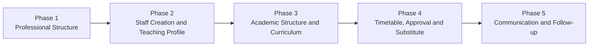
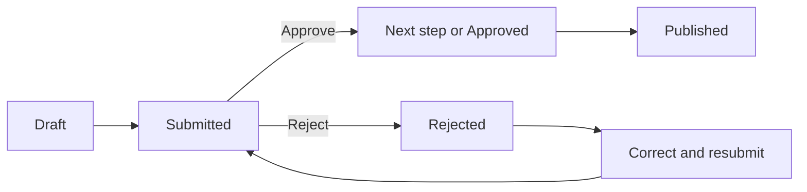

# Staff Phase 1–5 Complete Functional Flow — Hinglish Guide

> Consolidated client training, proposed-vs-implemented comparison, screenshots and 2026-10-14 local verification: [SKOLENZA_PHASE_0_TO_5_CONSOLIDATED_AUDIT_REPORT_HINGLISH.docx](SKOLENZA_PHASE_0_TO_5_CONSOLIDATED_AUDIT_REPORT_HINGLISH.docx). Scenario evidence: [phases 0–5 consolidated local smoke](../testing/staff/phases-0-5-consolidated-smoke/2026-10-14.md).

## Document purpose

Yeh document Institution Administrator, academic coordinator, timetable manager, teacher aur UI/API developers ko samjhata hai ki Staff Phase 1 se Phase 5 tak ek connected operational flow kaise kaam karta hai. Example institution `Sunrise International School` hai aur example teacher `Ananya Sharma` hai.

> Earlier flow replace nahi hua. Professional structure, staff profile aur academic assignment foundation same hai. Dynamic timetable approval, substitute coverage aur staff communication us foundation ke upar complete operational layers hain.

## End-to-end map



## Running example

- Institution: Sunrise International School
- Staff member: Ananya Sharma
- Primary responsibility: Mathematics Teacher
- Additional teaching: Grade 5-A Science and Grade 6-B Mathematics

---

## Phase 1 — Staff Professional Structure

Institution apna professional hierarchy configure karta hai:

| Level | Example |
| --- | --- |
| Staff Category | Teaching |
| Job Family | Academics |
| Position | Teacher |
| Capability | Mathematics Teaching |
| Duties | Lesson Planning, Classroom Teaching, Student Assessment |

`Teaching` category se relevant Job Families milti hain, aur selected Job Family se relevant Positions. Institution-owned relationship ki wajah se unrelated combination consumer screen par hardcode nahi hota.

Capability batati hai ki staff kya karne ke योग्य hai. Duty batati hai ki us position se actual kaam kya expected hai. Example: `Mathematics Teaching` capability hai; `Lesson Planning` aur `Student Assessment` duties hain.

Parent record deactivate/remove karne se pehle dependent child mappings handle honi chahiye:

```text
Duty/Capability mapping → Position → Job Family → Staff Category
```

Remove ka operational meaning deactivation hai. Edit karke `Active` karne par institution record dobara use kar sakta hai. Ek institution ka change doosre institution ke catalogue ko affect nahi karta.

---

## Phase 2 — Staff Creation and Teaching Profile

Ananya ka Staff Member record banate waqt professional selections save hongi:

| Field | Value |
| --- | --- |
| Staff Category | Teaching |
| Job Family | Academics |
| Position | Teacher |
| Department | Mathematics Department |
| Designation | Mathematics Teacher |
| Employment Type | Permanent |
| Access Role | Staff Member |

Staff Category select karne par related Job Families aur Job Family select karne par related Positions load hoti hain. Ye selections create API, overview/read contract aur edit/update flow mein consistent rehni chahiye.

### Position aur subject assignment alag kyun hain?

`Teacher` Ananya ki professional position hai. Wo kin subjects/classes ko padhati hai, ye separate teaching assignments hain:

| Assignment | Subject | Class/Section | Responsibility |
| --- | --- | --- | --- |
| 1 | Mathematics | Grade 5-A | Primary |
| 2 | Science | Grade 5-A | Additional |
| 3 | Mathematics | Grade 6-B | Additional |

Is model se ek teacher ka primary subject ho sakta hai aur wo multiple classes/subjects bhi le sakta hai.

---

## Phase 3 — Academic Structure and Curriculum

Academic structure institution-owned aur configurable hai. School, college aur coaching centre same model ko apni terminology/data ke saath use kar sakte hain.

### Session

- School: Academic Year 2026–27
- College: Semester Cycle 2026–27
- Coaching: JEE 2027 Batch Cycle

### Programme

- School: Primary School, Middle School, Secondary School
- College: B.Sc., B.Com., B.Tech.
- Coaching: JEE Foundation, NEET Target Batch

### Academic Group

- School: Grade 5, Grade 6
- College: B.Sc. First Year, B.Tech Semester 3
- Coaching: JEE Morning Batch, NEET Weekend Batch

### Section

Admin required sections khud banata hai: `5-A`, `5-B`, `5-C`, ya sirf `5-A`. College `CSE Semester 3 – Batch B` aur coaching `JEE Morning – Batch A` rakh sakte hain. Grade/section hardcoded nahi hai.

### Subject and Course Offering

Subject central institution catalogue record hai, jaise Mathematics, Science aur English. Course Offering subject ko session aur academic group se जोड़ता hai:

```text
Session: 2026–27
Academic Group: Grade 5
Subject: Mathematics
Course Offering: Grade 5 – Mathematics
```

College example `Semester 3 + Data Structures` aur coaching example `JEE 2027 Morning Batch + Advanced Mathematics` ho sakta hai.

### Curriculum

Course Offering ke andar curriculum framework, units aur topics configured hote hain:

```text
Framework: School Curriculum 2026–27
Course Offering: Grade 5 – Mathematics
Unit: Fractions
Topics: Types, Addition, Word Problems
Planned periods: 8
```

Lesson planning, actual delivery aur syllabus progress isi hierarchy ko consume karte hain.

---

## Phase 4 — Timetable, Approval and Substitute

### Timetable kaun banata hai?

Institution workflow decide karta hai:

1. Teacher ko Draft propose karne ki permission di ja sakti hai.
2. Timetable Manager ya authorized manager Draft create kar sakta hai.
3. Approval steps institution, campus ya section ke scope par configure ho sakte hain.
4. Final approval ke baad auto-publish ya authorized manual publish configure ho sakta hai.

Ananya ka example Draft:

```text
Monday · Period 2
Grade 5-A · Mathematics
Teacher: Ananya Sharma
Room: 105
```

### Approval lifecycle



Possible approver types:

- Reporting Manager
- Access Role
- Position
- Named Staff Member

Example school workflow:

```text
Teacher submits → Grade Coordinator → Academic Head → Auto Publish
```

Example college workflow:

```text
Faculty submits → Head of Department → Dean Academics → Timetable Office publishes
```

API current actor ko current workflow step ke against validate karti hai. Angular `canReview` aur `canPublish` server flags ke अनुसार buttons dikhata hai. Sirf `SUBMITTED` status dekhna approval permission nahi deta.

### Published revision

Published row direct edit nahi hota:

```text
Published Revision 1 → Create Revision → Draft Revision 2
→ Approval → Published Revision 2
```

Previous revision aur approval history retained rehti hai.

### Approved leave and substitute

Ananya ki approved leave select karne par system affected timetable periods banata hai:

```text
18 October 2026
Grade 5-A Mathematics · Period 2
Grade 6-B Mathematics · Period 5
```

Substitute example:

```text
Original teacher: Ananya Sharma
Substitute: Rahul Verma
Date/period: 18 October · Period 2
```

Institution substitute workflow configure kar sakta hai:

```text
Academic Coordinator assigns → Department Head approves
→ Rahul accepts → Coverage confirmed
```

Supported actions workflow state ke अनुसार Approve, Reject, Accept, Decline aur Cancel hain.

---

## Phase 5 — Staff Communication

### Direct conversation

Teacher aur coordinator ki private discussion:

```text
Ananya: Grade 5-A Mathematics timetable assembly se overlap kar raha hai.
```

### Structured query

Institution-owned categories ke under formal query:

```text
Category: Timetable Issue
Subject: Grade 5-A overlap
```

Categories Timetable Issue, Leave Query, Academic Support ya institution ke apne records ho sakte hain.

### Broadcast

Audience dynamic ho sakti hai:

- Campus
- Department
- Staff Category
- Access Role
- Selected Staff Members

Server selected audience ko tenant-scoped staff recipients mein resolve karke participant snapshot save karta hai.

### Message attachment

Ananya apne message par `grade-5-a-revised-plan.pdf` attach kar sakti hai.

- Sirf sender apne message par attachment add kar sakta hai.
- Conversation open honi chahiye.
- Maximum file size 10 MB hai.
- Existing file-storage service object save karti hai.
- Metadata database mein save hota hai.
- UI time-limited signed link se file open karti hai.

---

## Ananya ka complete real-time sequence

1. Admin `Teaching → Academics → Teacher` professional hierarchy configure karta hai.
2. Ananya ka Staff Member profile create hota hai.
3. Primary `Grade 5-A Mathematics` aur additional teaching assignments add hote hain.
4. Session, Programme, Grade, Section, Subject aur Course Offering configured hote hain.
5. Mathematics curriculum mein Fractions unit aur topics planned hote hain.
6. Ananya ya manager timetable Draft banata hai, institution setting ke अनुसार.
7. Configured approvers review karte hain; final step timetable publish karta hai.
8. Approved leave se affected periods synchronize hote hain.
9. Rahul substitute assign hota hai, approval aur acceptance complete karta hai.
10. Direct/query conversation mein instructions aur documents share hote hain.

## Earlier explanation ke mukable final position

Foundation same hai:

- Position aur teaching assignments अलग records hain.
- Ek teacher multiple classes aur subjects le sakta hai.
- Grade, section aur institution catalogues hardcoded nahi hain.
- School, college aur coaching centre apni structure configure karte hain.
- Har record aur workflow institution-scoped hai.

Final implementation mein additional operational controls aaye hain:

- Draft/submit/approve/reject/publish timetable lifecycle
- Institution-configured approvers and publication rule
- Immutable published revisions and history
- Approved-leave impact and substitute workflow
- Direct/query/broadcast communication
- Actor-owned message attachments

Isliye pehle wala flow cancel nahi hua; ab wo complete governance aur daily-operation flow ke saath connected hai.

## Related implementation documents

- [Staff and Academic Setup — screenshot walkthrough in Hinglish](STAFF_AND_ACADEMIC_SETUP_WALKTHROUGH_HINGLISH.md)
- [Academic structure and teaching assignments](ACADEMIC_STRUCTURE_AND_TEACHING_ASSIGNMENTS.md)
- [Curriculum and lesson delivery](CURRICULUM_LESSON_DELIVERY.md)
- [Dynamic timetable approval](DYNAMIC_TIMETABLE_APPROVAL.md)
- [Timetable, substitute and communication API](STAFF_TIMETABLE_SUBSTITUTE_COMMUNICATION.md)
